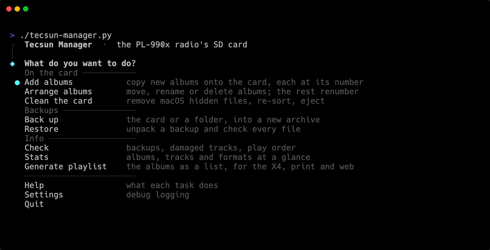

# tecsun-manager

Keeps the SD card in a Tecsun PL-990 radio tidy, in the right play order, and backed up.




## Why

The PL-990 plays albums from a microSD card, but it's fussy about it:

- It plays albums in the order they sit on the card, not by name. Add or rename an album and the order goes sideways.
- macOS leaves hidden files on any card you plug in, and the radio can list them as albums.
- When a track ends up stored in scattered pieces on the card, the radio lists it, then skips it.

I fill my card and then barely touch it for years. By the time I want to change something, I've forgotten every trick. So this script handles the fussy parts, explains itself as it goes, and asks before it changes anything.


## What it does

- **Add albums**: copies new albums onto the card, each at the spot its number says, and renumbers the rest.
- **Arrange albums**: moves, renames or deletes albums, then renumbers the rest to stay accurate.
- **Clean the card**: clears out macOS's hidden files, finds tracks stored in pieces and offers to fix them, sorts the card and ejects it.
- **Back up**: saves the whole card as one archive with checksums, reads it back to check every file, then adds repair data.
- **Restore**: unpacks a backup and checks every file.
- **Check**: verifies a backup, finds damaged tracks, or reads the card's play order.
- **Stats**: shows what's on the card and how full it is.
- **Generate playlist**: makes a list of the card's albums as an EPUB, a PDF you print and fold into the radio's case, and a web page. [See examples](examples/).

[More screenshots](screenshots/)


## Install

You'll need macOS (Linux works too), [uv](https://docs.astral.sh/uv/) and [fatsort](https://fatsort.sourceforge.io).

```bash
brew install uv fatsort par2 flac ffmpeg
git clone https://github.com/epohs/tecsun-manager.git
cd tecsun-manager
./tecsun-manager.py
```

The first run fetches Python 3.14 and everything else it needs. par2, flac and ffmpeg are optional: par2 adds repair data to backups, and flac or ffmpeg checks tracks for damage. The script tells you what's missing.

To run it from anywhere as `tecsun-manager`:

```bash
mkdir -p ~/.local/bin
printf '#!/bin/sh\nexec "%s/tecsun-manager.py" "$@"\n' "$PWD" > ~/.local/bin/tecsun-manager
chmod +x ~/.local/bin/tecsun-manager
```

If `tecsun-manager` isn't found afterwards, run `uv tool update-shell` and open a new terminal.


## Usage

Run it with no options for the menu, then answer the questions. Or jump straight to one task:

```bash
./tecsun-manager.py           # the menu
./tecsun-manager.py --clean   # just one task
./tecsun-manager.py --help    # every option
```

Albums are folders named with their place in line, like `01 - The Beach Boys - Pet Sounds`. The number sets the play order, and the script keeps the card sorted to match.

The [manual](MANUAL.md) covers every option and every task in the menu.


## License

[GPL-3.0-or-later](LICENSE). Use it, change it, share it. If you share a changed version, share its source under the same license.
