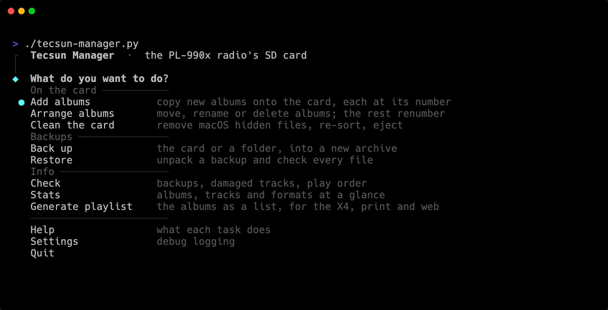
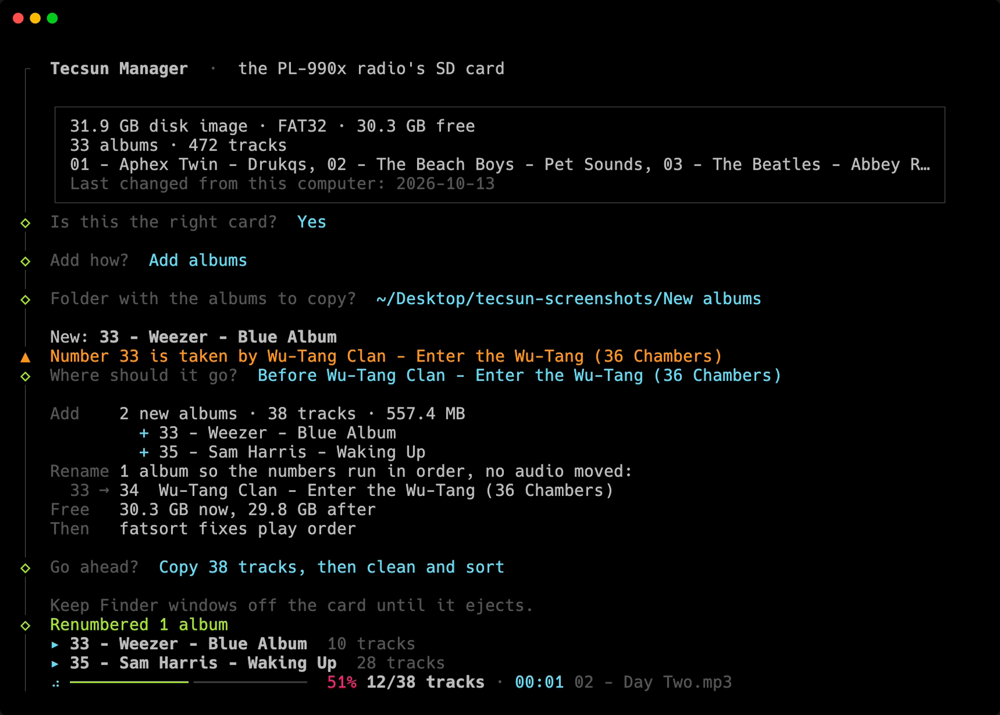
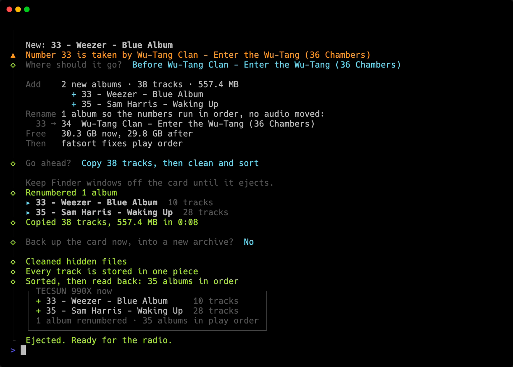
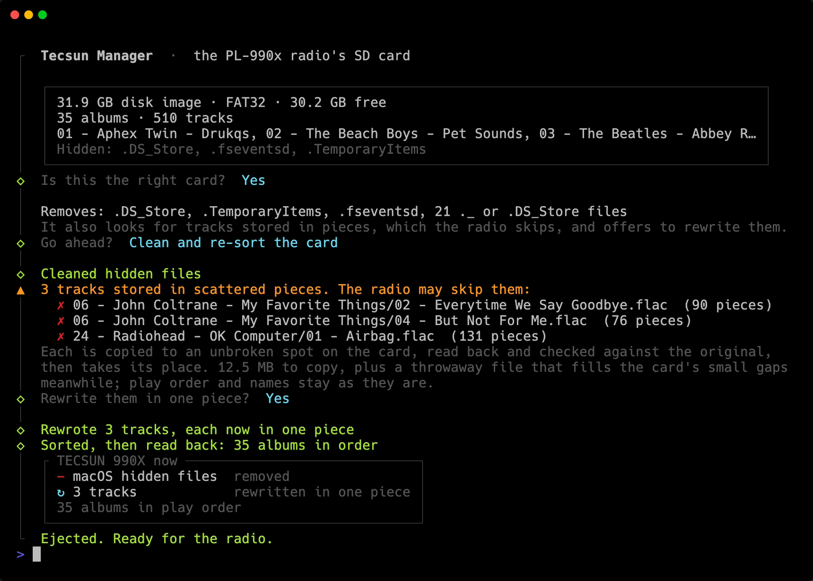
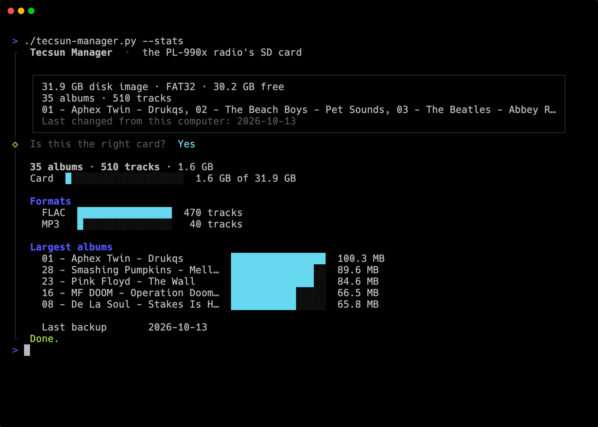

# Screenshots

| Screenshot | What it shows |
|---|---|
|  | **The menu.** Every task, grouped by what it does |
|  | **Adding albums.** The script shows you the plan first: where each new album goes, what gets renumbered, and how much room it takes. Then it copies the tracks |
|  | **What changed.** Once the albums are added, you get a summary: what was copied, that the card was cleaned, sorted and checked, and a box showing what's new on it |
|  | **Cleaning the card.** The script removes the hidden files macOS left on the card, and rewrites any tracks that were stored in pieces so each is whole again |
|  | **Stats.** The SD card at a glance |

My radio is the PL-990x, a near-identical version of the PL-990, so that's the name you'll see in the screenshots.
